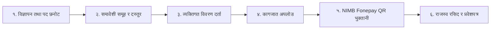

# पाँचपोखरी थाङपाल गाउँपालिका — खुला अनलाइन दरखास्त सचित्र प्रयोगकर्ता निर्देशिका (Visual Step-by-Step User Manual)

> **उद्देश्य:** सर्वसाधारण नागरिक तथा उम्मेदवारहरूलाई खुला विज्ञापनमा घरमै बसी अनलाइन आवेदन फारम भर्ने, कागजात अपलोड गर्ने, नेपाल इन्भेष्टमेन्ट मेगा बैंक (NIMB) को खातामा Fonepay Dynamic QR मार्फत दस्तुर भुक्तानी गर्ने र आधिकारिक राजस्व रसिद तथा प्रवेशपत्र प्राप्त गर्ने विस्तृत सचित्र मार्गदर्शन।

---

## अनलाइन दरखास्तका ६ मुख्य चरणहरू (Application Workflow)

---

## चरण १: खुला अनलाइन दरखास्त पोर्टलमा प्रवेश गर्नुहोस्

१. आफ्नो कम्प्युटर वा मोबाइल ब्राउजरमा **[https://digitaltwin.smartptrm.com/recruitment](https://digitaltwin.smartptrm.com/recruitment)** खोल्नुहोस्।  
२. स्क्रिनको माथिल्लो भागमा रहेको **"अनलाइन दरखास्त फारम (Apply Now)"** बटनमा क्लिक गर्नुहोस् वा तलको विज्ञापन तालिकामा आफू योग्य भएको पदको दायाँपट्टि रहेको **"दरखास्त दिनुहोस्"** बटनमा थिच्नुहोस्।

*चित्र १: सार्वजनिक अनलाइन दरखास्त पोर्टल तथा खुला विज्ञापन सूची*

---

## चरण २: पद र समावेशी समूह छनोट गर्नुहोस्

१. **खुला विज्ञापन तथा पद छनोट:** ड्रपडाउन सूचीबाट आफूले दरखास्त दिन चाहेको पद छनोट गर्नुहोस् (उदा: *नापी सर्वेक्षक / नापी अधिकृत*)।  
२. **समावेशी समूह छनोट:** खुला बाहेक यदि तपाईं महिला, आदिवासी जनजाति, मधेसी, दलित, अपाङ्ग वा पिछडिएको क्षेत्रबाट पनि प्रतिस्पर्धा गर्न चाहनुहुन्छ भने सो समूहको कार्डमा क्लिक गर्नुहोस्।  
३. **स्वतः दस्तुर निर्धारण:** प्रत्येक थप समावेशी समूहका लागि तोकिएको अतिरिक्त दस्तुर (रु. २००/-) स्वतः हिसाब भई **कुल निर्धारण भएको दरखास्त दस्तुर** स्क्रिनमा देखिन्छ।  
४. विवरण रुजु गरी **"अर्को चरण (व्यक्तिगत विवरण)"** बटनमा क्लिक गर्नुहोस्।

*चित्र २: पद र समावेशी समूह छनोट तथा दस्तुरको स्वतः हिसाब*

---

## चरण ३: उम्मेदवारको व्यक्तिगत विवरण र सम्पर्क भर्नुहोस्

१. **उम्मेदवारको पूरा नाम (नेपालीमा):** नागरिकता अनुसार आफ्नो नाम शुद्ध नेपाली युनिकोडमा लेख्नुहोस् (उदा: *राम बहादुर श्रेष्ठ*)।  
२. **Full Name in English:** अंग्रेजी ठूलो अक्षर (BLOCK LETTERS) मा नाम लेख्नुहोस्।  
३. **जन्ममिति (वि.सं.):** नेपाली पात्रो (क्यालेन्डर) बाट आफ्नो जन्ममिति छनोट गर्नुहोस्।  
४. **नागरिकता विवरण:** नागरिकता नम्बर र जारी जिल्ला (उदा: *सिन्धुपाल्चोक*) भर्नुहोस्।  
५. **सम्पर्क मोबाइल नम्बर:** आफ्नो सक्रिय १० अङ्कको मोबाइल नम्बर अनिवार्य भर्नुहोस् (यसै नम्बरमा फारम स्वीकृतिको सूचना र प्रवेशपत्र प्राप्त हुनेछ)।  
६. **ठेगाना:** स्थायी र हालको बसोबास ठेगाना भरेर **"अर्को चरण (योग्यता र कागजात)"** बटनमा क्लिक गर्नुहोस्।

*चित्र ३: व्यक्तिगत विवरण तथा मोबाइल नम्बर प्रविष्टि*

---

## चरण ४: शैक्षिक योग्यता र आवश्यक कागजातहरू अपलोड गर्नुहोस्

१. **शैक्षिक विवरण:** तोकिएको न्यूनतम योग्यता, अध्ययन गरेको संस्था (CTEVT / TU), उत्तीर्ण साल र श्रेणी/GPA प्रविष्ट गर्नुहोस्।  
२. **अनिवार्य ४ वटा कागजातहरू अपलोड गर्नुहोस् (अधिकतम १५ MB सम्म - JPG वा PDF):**
   - **पासपोर्ट साइजको फोटो:** हालसालै खिचिएको अनुहार प्रष्ट देखिने रंगीन फोटो।
   - **उम्मेदवारको दस्तखत (हस्ताक्षर):** सेतो कागजमा कालो वा नीलो मसीले गरिएको हस्ताक्षर।
   - **नागरिकता प्रमाणपत्र:** अगाडि र पछाडिको भाग प्रष्ट बुझिने।
   - **शैक्षिक लब्धाङ्क पत्र (Transcript):** सम्बन्धित तहको प्रमाणपत्र।
३. कागजात अपलोड भएपछि हरियो टिक र **"हेर्नुहोस्"** लिङ्क देखिन्छ।  
४. तल रहेको **स्वघोषणा तथा सर्त मन्जुरी** को बक्समा टिक लगाउनुहोस्।  
५. **"दरखास्त सुरक्षित गर्नुहोस् र भुक्तानीमा जानुहोस्"** बटन थिच्नुहोस्।

*चित्र ४: फोटो, दस्तखत, नागरिकता, शैक्षिक प्रमाणपत्र अपलोड र स्वघोषणा*

---

## चरण ५: NIMB Bank Fonepay Dynamic QR बाट दस्तुर भुक्तानी गर्नुहोस्

> [!IMPORTANT]
> **पाँचपोखरी थाङपाल गाउँ कार्यपालिका — आधिकारिक बैंक खाता विवरण:**  
> - **बैंकको नाम:** नेपाल इन्भेष्टमेन्ट मेगा बैंक (NIMB)  
> - **खाता नम्बर:** `18301400000109`  
> - **खातावालाको नाम:** `GA 1.1 PANCHPOKHARI THANGPAL GA.PA. AANTARIK RAJASHO KHATA`  

१. स्क्रिनमा तपाईंको आवेदनका लागि तोकिएको रकम र कारोबार संकेतसहितको **Fonepay Dynamic QR Code** खुल्नेछ।  
२. आफ्नो मोबाइलमा रहेको जुनसुकै बैंकको **Mobile Banking एप** (NIMB Smart, Global Smart Plus, NIC Asia MoBank, Nabil Smart, आदि) वा **eSewa / Khalti** खोल्नुहोस्।  
३. एपको **Scan QR** बाट स्क्रिनको QR कोड स्क्यान गर्नुहोस्।  
४. खातावालाको नाम (गाउँपालिकाको आन्तरिक राजस्व खाता) र रकम रुजु गरी आफ्नो गोप्य पिन हानेर भुक्तानी स्वीकृत गर्नुहोस्।  
५. मोबाइलमा भुक्तानी सफल हुनासाथ स्क्रिनको हरियो बटन **"मैले भुक्तानी सम्पन्न गरें (Verify & Confirm)"** मा क्लिक गर्नुहोस्।

*चित्र ५: NIMB राजस्व खाता, Fonepay Dynamic QR र काउन्टडाउन टाइमर*

---

## चरण ६: आधिकारिक राजस्व रसिद र दरखास्त पुष्टि प्राप्त गर्नुहोस्

१. भुक्तानी रुजु भएपछि आवेदन तत्काल आधिकारिक रूपमा दर्ता हुन्छ र स्थिति **"SUBMITTED & PAID (सफल)"** हुन्छ।  
२. स्क्रिनमा गाउँपालिकाको आधिकारिक राजस्व शीर्षक **१४२२९ (परीक्षा शुल्क)**, दरखास्त नम्बर, र भुक्तानी रुजु QR कोडसहितको **आधिकारिक राजस्व रसिद (Government Revenue Receipt)** खुल्नेछ।  
३. **"रसिद प्रिन्ट / डाउनलोड गर्नुहोस्"** बटन थिची रसिद प्रिन्ट वा PDF मा सुरक्षित गर्नुहोस्।

*चित्र ६: भुक्तानी सफल भएपछि जारी हुने आधिकारिक डिजिटल राजस्व रसिद (शीर्षक १४२२९)*

---

## चरण ७: प्रवेशपत्र (Admit Card) तथा आवेदन स्थिति खोज्नुहोस्

१. पोर्टलको **"प्रवेशपत्र तथा आवेदन स्थिति खोज्नुहोस्"** ट्याबमा जानुहोस्।  
२. आफ्नो **दरखास्त नम्बर**, **नागरिकता नम्बर** वा **मोबाइल नम्बर** टाइप गरी **"खोज्नुहोस्"** मा थिच्नुहोस्।  
३. कार्यालयबाट फारम रुजु भएपछि जारी हुने **रोल नम्बर र परीक्षा केन्द्रसहितको प्रवेशपत्र** यहाँबाट हेर्न र प्रिन्ट गर्न सकिन्छ।  
४. यदि भुक्तानी अधुरो रहेको भए यहाँबाट सिधै **"बाँकी शुल्क भुक्तानी गर्नुहोस्"** थिची पुनः भुक्तानी गर्न सकिन्छ।

*चित्र ७: मोबाइल नम्बर वा दरखास्त नम्बरबाट स्थिति खोजी र प्रवेशपत्र प्राप्ति*

---

## प्राविधिक सहायता तथा सम्पर्क
- **वेब पोर्टल:** [https://digitaltwin.smartptrm.com/recruitment](https://digitaltwin.smartptrm.com/recruitment)
- **सचित्र निर्देशिका (वेब संस्करण):** [https://digitaltwin.smartptrm.com/HOW_TO_APPLY.html](https://digitaltwin.smartptrm.com/HOW_TO_APPLY.html)
- **कार्यालय:** गाउँ कार्यपालिकाको कार्यालय, थाङपालधाप, पाँचपोखरी थाङपाल, सिन्धुपाल्चोक
- **इमेल:** ito.panchpokharithangpalmun@gmail.com
- **आधिकारिक राजस्व खाता:** नेपाल इन्भेष्टमेन्ट मेगा बैंक (NIMB) — खाता नं: `18301400000109`
