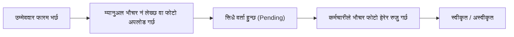
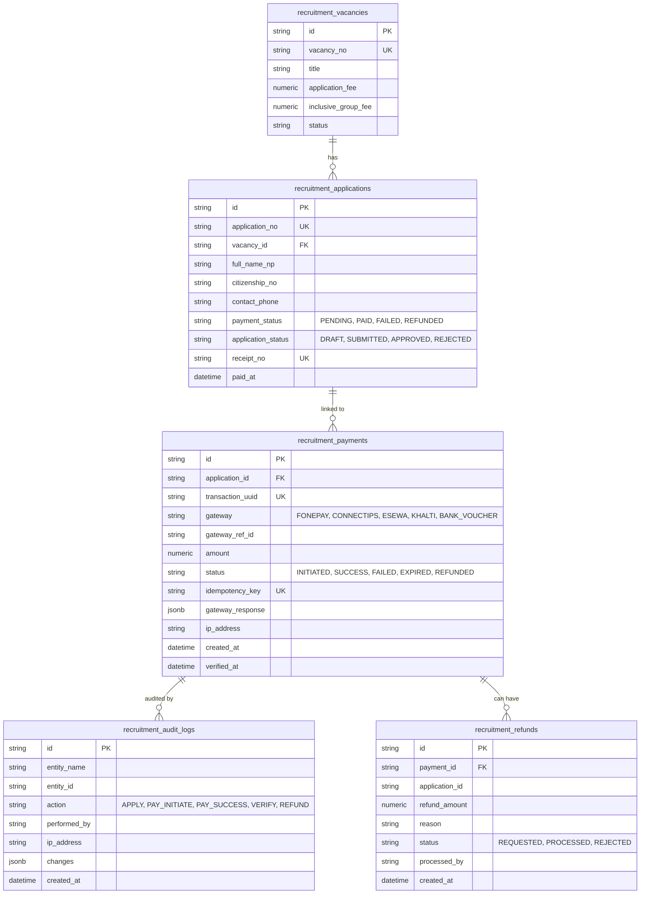
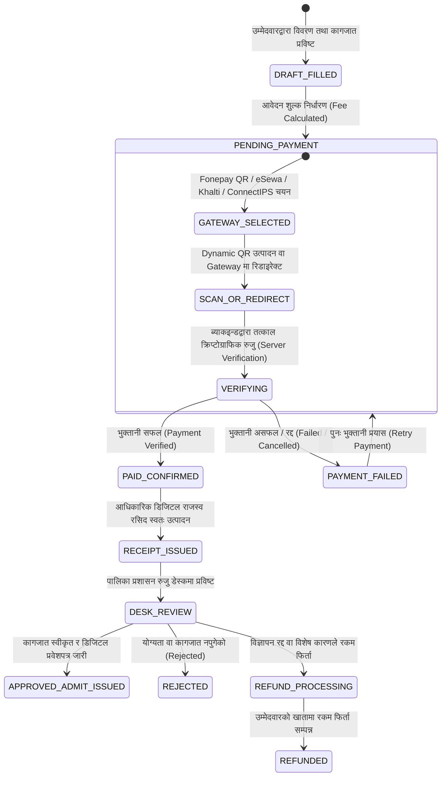
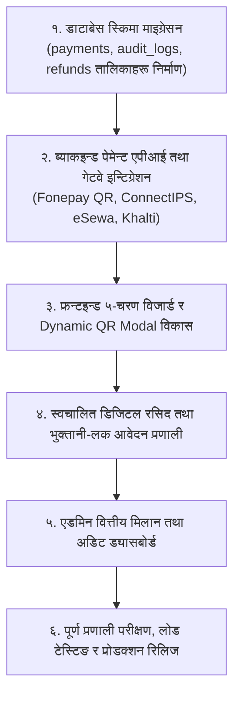

# पाँचपोखरी थाङपाल गाउँपालिका (Panchpokhari Thangpal Rural Municipality)
## अनलाइन दरखास्त तथा कर्मचारी पदपूर्ति व्यवस्थापन प्रणाली (Online Recruitment & Vacancy Management System)
### विद्यमान प्रणाली अडिट (System Audit), प्राविधिक कार्यान्वयन योजना (Implementation Plan) तथा पूर्ण प्रयोगकर्ता निर्देशिका (User Manual)

---

> [!IMPORTANT]
> **प्रणाली ठेगाना:** [https://digitaltwin.smartptrm.com/app/recruitment](https://digitaltwin.smartptrm.com/app/recruitment) (सार्वजनिक पोर्टल: `/recruitment`, कार्यालय प्रशासन डेस्क: `/app/recruitment`)  
> **प्रस्तुत मिति:** वि.सं. २०८१ मंसिर (नोभेम्बर २०२६)  
> **अवस्था:** विद्यमान प्रणाली अडिट सम्पन्न; विकास पूर्व स्वीकृति (User Approval) का लागि पेश गरिएको।

---

## विषयसूची (Table of Contents)
1. [कार्यकारी सारांश (Executive Summary)](#१-कार्यकारी-सारांश-executive-summary)
2. [भाग १: विद्यमान प्रणालीको विस्तृत अडिट प्रतिवेदन (Existing System Audit)](#भाग-१-विद्यमान-प्रणालीको-विस्तृत-अडिट-प्रतिवेदन-existing-system-audit)
   - [१.१ आर्किटेक्चर तथा हालको प्रविधि संरचना](#११-आर्किटेक्चर-तथा-हालको-प्रविधि-संरचना)
   - [१.२ डाटाबेस स्किमा तथा डेटा मोडेल विश्लेषण](#१२-डाटाबेस-स्किमा-तथा-डेटा-मोडेल-विश्लेषण)
   - [१.३ हालको दरखास्त तथा भुक्तानी प्रक्रियाको समीक्षा](#१३-हालको-दरखास्त-तथा-भुक्तानी-प्रक्रियाको-समीक्षा)
   - [१.४ पहिचान गरिएका गम्भीर प्राविधिक तथा प्रक्रियागत त्रुटिहरू (Identified Gaps)](#१४-पहिचान-गरिएका-गम्भीर-प्राविधिक-तथा-प्रक्रियागत-त्रुटिहरू-identified-gaps)
3. [भाग २: नेपालका डिजिटल भुक्तानी प्रणालीहरूको सम्भाव्यता अध्ययन (Nepal Payment Gateways Feasibility)](#भाग-२-नेपालका-डिजिटल-भुक्तानी-प्रणालीहरूको-सम्भाव्यता-अध्ययन-nepal-payment-gateways-feasibility)
   - [२.१ Fonepay Dynamic EMVCo QR](#२१-fonepay-dynamic-emvco-qr)
   - [२.२ ConnectIPS (NCHL - राष्ट्रिय भुक्तानी स्वीच)](#२२-connectips-nchl---राष्ट्रिय-भुक्तानी-स्वीच)
   - [२.३ eSewa ePay v2](#२३-esewa-epay-v2)
   - [२.४ Khalti ePayment v2](#२४-khalti-epayment-v2)
   - [२.५ ग्रामीण तथा अफलाइन सेवाग्राहीका लागि बैकल्पिक व्यवस्था (Bank Voucher Fallback)](#२५-ग्रामीण-तथा-अफलाइन-सेवाग्राहीका-लागि-बैकल्पिक-व्यवस्था-bank-voucher-fallback)
4. [भाग ३: प्रस्तावित प्राविधिक सुधार तथा कार्यान्वयन योजना (Implementation Plan)](#भाग-३-प्रस्तावित-प्राविधिक-सुधार-तथा-कार्यान्वयन-योजना-implementation-plan)
   - [३.१ नयाँ डाटाबेस तालिका तथा स्किमा विस्तार](#३१-नयाँ-डाटाबेस-तालिका-तथा-स्किमा-विस्तार)
   - [३.२ State Machine & Payment Lifecycle](#३२-state-machine--payment-lifecycle)
   - [३.३ ब्याकइन्ड एपीआई आर्किटेक्चर (FastAPI)](#३३-ब्याकइन्ड-एपीआई-आर्किटेक्चर-fastapi)
   - [३.४ फ्रन्टइन्ड ५-चरणको विजार्ड (5-Step Wizard UI/UX)](#३४-फ्रन्टइन्ड-५-चरणको-विजार्ड-5-step-wizard-uiux)
   - [३.५ स्वचालित डिजिटल राजस्व रसिद (Automated Official Receipt)](#३५-स्वचालित-डिजिटल-राजस्व-रसिद-automated-official-receipt)
   - [३.६ सुरक्षा, डुप्लिकेट भुक्तानी नियन्त्रण र अडिट लग (Security & Audit Trail)](#३६-सुरक्षा-डुप्लिकेट-भुक्तानी-नियन्त्रण-र-अडिट-लग-security--audit-trail)
   - [३.७ फिर्ता (Refund) तथा वित्तीय मेलमिलाप (Reconciliation) मोड्युल](#३७-फिर्ता-refund-तथा-वित्तीय-मेलमिलाप-reconciliation-मोड्युल)
5. [भाग ४: आधिकारिक विस्तृत प्रयोगकर्ता निर्देशिका (Comprehensive User Manual)](#भाग-४-आधिकारिक-विस्तृत-प्रयोगकर्ता-निर्देशिका-comprehensive-user-manual)
   - [४.१ खण्ड 'क': उम्मेदवार तथा नागरिक प्रयोगकर्ता निर्देशिका (Candidate User Manual)](#४१-खण्ड-क-उम्मेदवार-तथा-नागरिक-प्रयोगकर्ता-निर्देशिका-candidate-user-manual)
   - [४.२ खण्ड 'ख': पालिका कर्मचारी तथा प्रशासन निर्देशिका (Admin & HR Desk Manual)](#४२-खण्ड-ख-पालिका-कर्मचारी-तथा-प्रशासन-निर्देशिका-admin--hr-desk-manual)
6. [भाग ५: कार्यान्वयन कार्यतालिका तथा स्वीकृति अनुरोध (Approval & Next Steps)](#भाग-५-कार्यान्वयन-कार्यतालिका-तथा-स्वीकृति-अनुरोध-approval--next-steps)

---

## १. कार्यकारी सारांश (Executive Summary)

पाँचपोखरी थाङपाल गाउँपालिकाको **Online Recruitment & Employee Vacancy Management System** स्थानीय तहमा आवश्यक जनशक्ति (करार सेवा, प्राविधिक, प्रशासनिक आदि) को पदपूर्ति प्रक्रियालाई पारदर्शी, निष्पक्ष, समयमै र प्रविधिमैत्री बनाउन निर्माण गरिएको डिजिटल पूर्वाधार हो।

हालको प्रणालीले विज्ञापन प्रकाशन, आवेदन संकलन, कागजात अपलोड र प्रवेशपत्र खोजीको आधारभूत ढाँचा प्रदान गरे तापनि **वास्तविक भुक्तानी एकीकरण (Online Payment Gateway Integration), भुक्तानी प्रमाणीकरण (Payment Verification), भुक्तानीपछि मात्र आवेदन दर्ता हुने कडा नियन्त्रण (Payment-Locked Application Submission), स्वतः डिजिटल रसिद उत्पादन (Auto Receipt Generation) र अडिट लग (Audit Logging)** जस्ता संवेदनशील बैंकिङ तथा वित्तीय सुरक्षा पक्षहरूमा अपूर्णता रहेको पाइएको छ।

प्रस्तुत प्रतिवेदनमा वर्तमान प्रणालीको विस्तृत प्राविधिक अडिट, नेपालका मुख्य भुक्तानी प्रणालीहरूसँगको सुरक्षित इन्टिग्रेशन खाका, कार्यान्वयन योजना र पूर्ण User Manual समावेश गरिएको छ।

---

## भाग १: विद्यमान प्रणालीको विस्तृत अडिट प्रतिवेदन (Existing System Audit)

### १.१ आर्किटेक्चर तथा हालको प्रविधि संरचना
- **होस्टिङ तथा वेब सर्भर:** Windows Server मा IIS (Internet Information Services) मार्फत `https://digitaltwin.smartptrm.com` डोमेनमा SSL (HTTPS:443) सहित सञ्चालन।
- **ब्याकइन्ड (Backend):** Python 3.11/3.13 + **FastAPI** फ्रेमवर्क (Port 3002 मा Uvicorn सर्भिस सञ्चालनमा रहेको), जसमा IIS Rewrite Rule मार्फत `/api/*` र `/uploads/*` प्रोक्सी गरिएको छ।
- **डाटाबेस (Database):** **PostgreSQL 16** (`municipal_twin_db`) सँग SQLAlchemy ORM र Psycopg ड्राइभर।
- **फ्रन्टइन्ड (Frontend):** **React 19**, TypeScript, Vite, TanStack React Query, Tailwind/Modular CSS, Lucide Icons, xlsx, qrcode।
- **राउटिङ संरचना:**
  - `https://digitaltwin.smartptrm.com/recruitment` -> सार्वजनिक नागरिक पोर्टल (विज्ञापन अवलोकन, दरखास्त फारम, प्रवेशपत्र प्रिन्ट)।
  - `https://digitaltwin.smartptrm.com/app/recruitment` -> पालिका प्रशासन डेस्क (दरखास्त रुजु, कागजात जाँच, नयाँ विज्ञापन आह्वान, Excel निर्यात)।

### १.२ डाटाबेस स्किमा तथा डेटा मोडेल विश्लेषण
हालको डाटाबेसमा पदपूर्ति सम्बन्धी २ वटा मुख्य तालिकाहरू विद्यमान छन्:

#### १. `recruitment_vacancies` (विज्ञापन विवरण तालिका)
- **फिल्डहरू:** `id` (UUID), `vacancy_no`, `title`, `service_group`, `level`, `openings_count`, `employment_type`, `application_fee` (Numeric 10,2), `min_qualification`, `publish_date_bs`, `deadline_date_bs`, `exam_date_bs`, `status`, `description`, `created_at`।
- **विश्लेषण:** एकल आवेदन शुल्क मात्र छ। समावेशी समूह (खुला, महिला, जनजाति, दलित आदि) का लागि थप शुल्क (Inclusive Category Fee) निर्धारण गर्ने संरचना छैन।

#### २. `recruitment_applications` (दरखास्त विवरण तालिका)
- **फिल्डहरू:** `id`, `application_no`, `vacancy_id`, `vacancy_no`, `post_title`, `full_name_np`, `full_name_en`, `dob_bs`, `gender`, `citizenship_no`, `citizenship_district`, `contact_phone`, `email`, `permanent_address`, `temporary_address`, `qualification_title`, `board_university`, `passed_year_bs`, `division_gpa`, `council_reg_no`, `experience_years`, `payment_method`, `payment_voucher_no`, `status`, `rejection_reason`, `admit_card_roll_no`, `exam_center`, `exam_date_time`, `photo_url`, `signature_url`, `citizenship_doc_url`, `qualification_doc_url`, `council_doc_url`, `experience_doc_url`, `payment_voucher_doc_url`, `documents_json`, `created_at`।

### १.३ हालको दरखास्त तथा भुक्तानी प्रक्रियाको समीक्षा
वर्तमान प्रणालीमा उम्मेदवारले दरखास्त पेश गर्दा निम्न प्रक्रिया अपनाइन्छ:
1. उम्मेदवारले पद छनोट गर्छ र व्यक्तिगत तथा शैक्षिक विवरण भर्छ।
2. कागजात (फोटो, दस्तखत, नागरिकता, लब्धाङ्क आदि) सिधै `/api/v1/recruitment/upload-document` मा अपलोड गर्छ।
3. भुक्तानी खण्डमा ड्रपडाउनबाट "eSewa / Khalti / ConnectIPS" वा "राजस्व रसिद" छान्छ र एउटा **म्यानुअल टेक्स्ट फिल्ड** मा भाैचर नम्बर टाइप गर्छ वा भौचरको फोटो अपलोड गर्छ।
4. "Submit" बटन थिच्नासाथ आवेदन तुरुन्तै `विचाराधीन (Pending)` स्थितिमा डाटाबेसमा सेभ हुन्छ र `APP-2081-XXXX` नम्बर जारी हुन्छ।

### १.४ पहिचान गरिएका गम्भीर प्राविधिक तथा प्रक्रियागत त्रुटिहरू (Identified Gaps)

> [!WARNING]
> **गम्भीर समस्या १: अनलाइन भुक्तानी बिना नै आवेदन दर्ता हुनु**  
> हाल कुनै पनि उम्मेदवारले नक्कली वा काल्पनिक भाैचर नम्बर (`TXN-12345`) हालेर पनि आवेदन सफलतापूर्वक पेश गर्न सक्छ। यसले गर्दा कार्यालयमा फर्जी आवेदनहरूको चाप बढ्छ।

> [!WARNING]
> **गम्भीर समस्या २: भुक्तानी गेटवे र API को अभाव**  
> Fonepay QR, ConnectIPS, eSewa, वा Khalti सँग कुनै स्वचालित API Verification छैन। रकम वास्तवमै पालिकाको खातामा जम्मा भयो वा भएन भन्ने कुरा तुरुन्तै थाहा पाउन सकिँदैन।

> [!WARNING]
> **गम्भीर समस्या ३: डिजिटल राजस्व रसिद (Automated Receipt) को अभाव**  
> भुक्तानी सफल भएपछि उम्मेदवारले सुरक्षित, आधिकारिक छाप र QR कोडसहितको राजस्व रसिद डाउनलोड गर्न पाउँदैन।

> [!WARNING]
> **गम्भीर समस्या ४: असफल भुक्तानी पुनः प्रयास (Retry Payment) को अभाव**  
> यदि कुनै प्राविधिक कारणले भुक्तानी विच्छेद भयो भने, उम्मेदवारले पुनः भुक्तानी गर्ने कुनै विकल्प पाउँदैन; उसले फेरि सुरुदेखि नयाँ आवेदन भर्नुपर्ने बाध्यता छ।

> [!WARNING]
> **गम्भीर समस्या ५: दोहोरो भुक्तानी (Duplicate Payment) र वित्तीय अडिट लगको अभाव**  
> नेटवर्क ढिलाइ हुँदा एउटै आवेदनका लागि उम्मेदवारको २ पटक रकम काटिन सक्ने जोखिम छ। साथै कुन कर्मचारीले कहिले कुन कारोबार रुजु गर्‍यो भन्ने अपरिवर्तनीय Audit Trail छैन।

---

## भाग २: नेपालका डिजिटल भुक्तानी प्रणालीहरूको सम्भाव्यता अध्ययन (Nepal Payment Gateways Feasibility)

नेपालमा स्थानीय तहहरूका लागि उपयुक्त हुने गरी निम्न भुक्तानी प्रणालीहरूको सम्भाव्यता अध्ययन गरिएको छ:

| भुक्तानी प्रणाली | प्राविधिक ढाँचा | उपयुक्तता / पहुँच | सुरक्षा प्रमाणीकरण विधि | कार्यान्वयन प्राथमिकता |
| :--- | :--- | :--- | :--- | :--- |
| **Fonepay Dynamic QR** | EMVCo Merchant Presented QR API | नेपालका सम्पूर्ण वाणिज्य तथा विकास बैंकका Mobile Banking एपहरू (Global IME, Nabil, NIC Asia, आदि) र eSewa/Khalti बाट सिधै स्क्यान गर्न सकिने (सर्वोत्तम) | Dynamic Transaction ID, SHA256 Signature, Instant Webhook Callback / Status Inquire API | **उच्चतम (Primary)** |
| **ConnectIPS (NCHL)** | NCHL National Payment Switch Gateway | सरकारी राजस्व तथा पदपूर्तिका लागि नेपाल सरकार र महालेखा नियन्त्रक कार्यालय (FCGO) द्वारा मान्यता प्राप्त। नागरिकको खाताबाट सिधै पालिकाको सञ्चित कोषमा दाखिला | RSA Private/Public Key Token Signing, Server-to-Server Txn Verification | **उच्च (Official Gov Standard)** |
| **eSewa ePay v2** | REST Web Redirect + Form Post | नेपालको सबैभन्दा ठूलो डिजिटल वालेट, युवा उम्मेदवारहरूमाझ अत्यधिक लोकप्रिय | HMAC-SHA256 Secret Key Signature, Direct Server Status Query | **उच्च (Secondary)** |
| **Khalti ePayment v2** | REST API v2 (`epayment/initiate`) | आधुनिक Developer API, Instant Pidx, Mobile Friendly | Secret Key Bearer Auth, Server-side Lookup API | **उच्च (Secondary)** |
| **पालिका काउन्टर / बैंक भौचर** | अफलाइन बैंक दाखिला भौचर अपलोड | दुर्गम वडाका डिजिटल बैंकिङ नभएका विपन्न/ग्रामीण उम्मेदवारहरूका लागि समावेसी विकल्प | कर्मचारी द्वारा बैंक विवरण रुजु पश्चात मात्र Approved | **अनिवार्य ब्याकअप (Fallback)** |

### २.१ Fonepay Dynamic EMVCo QR
- **कार्यप्रणाली:** प्रणालीले विज्ञापनको दस्तुर, उम्मेदवारको नाम र दरखास्त नम्बर जोडेर Fonepay API मार्फत एउटा युनिक **Dynamic QR Code** उत्पादन गर्छ।
- **फाइदा:** उम्मेदवारले कुनै पनि बैंकको Mobile Banking एप खोलेर स्क्यान गर्न सक्छ। रकम र बिल नम्बर आफैं भरिएर आउने हुँदा रकम फरक पर्ने सम्भावना ०% हुन्छ।
- **प्रमाणीकरण:** ब्याकइन्डले हरेक ५ सेकेन्डमा Fonepay को `InquireTxnStatus` एपीआई कल गर्छ वा Fonepay ले Webhook मार्फत सफलताको जानकारी पठाउँछ।

### २.२ ConnectIPS (NCHL - राष्ट्रिय भुक्तानी स्वीच)
- **कार्यप्रणाली:** नेपाल सरकारको आधिकारिक मापदण्ड अनुसार ConnectIPS गेटवेमा रिडाइरेक्ट गराई नागरिकको बैंक खाताबाट सिधै रकम भुक्तानी हुन्छ।
- **फाइदा:** ठूलो रकम तथा सरकारी राजश्वका लागि सुरक्षित, भरपर्दो र शून्य/न्यूनतम सेवा शुल्क।

### २.३ eSewa ePay v2
- **कार्यप्रणाली:** उम्मेदवार eSewa पोर्टलमा पुग्छ, आफ्नो वालेट वा मोबाइल बैंकिङबाट रकम स्वीकृत गर्छ, र eSewa ले सफलताको टोकन सहित पुनः प्रणालीमा फर्काउँछ। प्रणालीको ब्याकइन्डले सिधै eSewa सर्भरसँग `status` जाँच गरी आवेदन Confirm गर्छ।

### २.४ Khalti ePayment v2
- **कार्यप्रणाली:** `api/v2/epayment/initiate/` मा `purchase_order_id` (दरखास्त नम्बर) पठाएर प्राप्त `payment_url` मा उम्मेदवारलाई रिडाइरेक्ट गरिन्छ। भुक्तानी पश्चात `lookup` एपीआई मार्फत ब्याकइन्डबाट प्रमाणीकरण हुन्छ।

---

## भाग ३: प्रस्तावित प्राविधिक सुधार तथा कार्यान्वयन योजना (Implementation Plan)

### ३.१ नयाँ डाटाबेस तालिका तथा स्किमा विस्तार

प्रणालीलाई सुदृढ बनाउन PostgreSQL मा निम्न तालिकाहरू थप तथा परिमार्जन गरिनेछ:

#### तालिका १: `recruitment_payments` (भुक्तानी अभिलेख)
- `id` (UUID PK)
- `application_id` (FK to recruitment_applications)
- `transaction_uuid` (युनिक कारोबार कोड: `TXN-REC-2081-XXXX`)
- `gateway` (FONEPAY_QR, CONNECTIPS, ESEWA, KHALTI, BANK_VOUCHER)
- `gateway_ref_id` (गेटवेले प्रदान गरेको आधिकारिक ट्रान्जेक्सन आईडी)
- `amount` (भुक्तानी गरिएको रकम रु.)
- `status` (`INITIATED`, `SUCCESS`, `FAILED`, `CANCELLED`, `REFUNDED`)
- `idempotency_key` (दोहोरो भुक्तानी रोक्न प्रयोग गरिने साँचो)
- `gateway_response` (गेटवेबाट आएको कच्चा JSON रेस्पोन्स)
- `ip_address` (उम्मेदवारको IP ठेगाना)
- `created_at`, `verified_at`

#### तालिका २: `recruitment_audit_logs` (अपरिवर्तनीय सुरक्षा लग)
- `id` (UUID)
- `entity_type` (APPLICATION, PAYMENT, VACANCY, ADMIT_CARD)
- `entity_id` (सम्बन्धित रेकर्डको आईडी)
- `action` (CREATE, PAYMENT_VERIFIED, STATUS_CHANGE, ROLL_ASSIGNED, REFUND_ISSUED)
- `performed_by` (SYSTEM, CANDIDATE, वा प्रशासकको नाम/इमेल)
- `ip_address`, `user_agent`, `payload`, `created_at`

#### तालिका ३: `recruitment_refunds` (रकम फिर्ता व्यवस्थापन)
- `id`, `payment_id`, `application_id`, `refund_amount`, `reason`, `bank_account_info`, `status`, `approved_by`, `created_at`

---

### ३.२ State Machine & Payment Lifecycle

नयाँ प्रणालीमा आवेदन र भुक्तानीको जीवनचक्र निम्न अनुसार कडाइका साथ नियन्त्रण हुनेछ:

> [!IMPORTANT]
> **मूल नियम:** भुक्तानी `PAID_CONFIRMED` नभएसम्म उम्मेदवारको दरखास्त कार्यालयको रुजु डेस्कमा स्वीकृतिका लागि जाँदैन। यदि उम्मेदवारले भुक्तानी गर्न सकेन भने उसले आफ्नो दरखास्त नम्बर वा फोन नम्बर हानेर जुनसुकै बेला **"बाँकी शुल्क भुक्तानी गर्नुहोस् (Retry Payment)"** बाट पुनः भुक्तानी गर्न सक्नेछ।

---

### ३.३ ब्याकइन्ड एपीआई आर्किटेक्चर (FastAPI)

FastAPI मा निम्न नयाँ तथा परिमार्जित Endpoints निर्माण गरिनेछ:

| Method | Endpoint | कार्य विवरण |
| :--- | :--- | :--- |
| `POST` | `/api/v1/recruitment/apply-draft` | उम्मेदवार विवरण तथा कागजात अस्थायी रूपमा सेभ गरी `application_no` र शुल्क निर्धारण गर्ने। |
| `POST` | `/api/v1/recruitment/payment/initiate` | चयन गरिएको गेटवे (Fonepay QR, eSewa, Khalti, ConnectIPS) का लागि भुक्तानी प्रारम्भ गर्ने र Dynamic QR / Redirect Payload दिने। |
| `POST` | `/api/v1/recruitment/payment/verify` | गेटवेबाट प्राप्त टोकन/कारोबार नम्बर सर्भर-टु-सर्भर रुजु गरी भुक्तानी `SUCCESS` बनाउने। |
| `GET` | `/api/v1/recruitment/payment/status/{app_no}` | पोलिङ वा कलब्याकका लागि भुक्तानी अवस्था (PAID/PENDING/FAILED) पत्ता लगाउने। |
| `GET` | `/api/v1/recruitment/receipt/{app_no}` | आधिकारिक छाप, बारकोड र QR कोडसहितको डिजिटल राजस्व रसिद (JSON / Printable View) दिने। |
| `POST` | `/api/v1/recruitment/payment/retry` | असफल वा विचाराधीन आवेदनको पुनः भुक्तानी प्रारम्भ गर्ने। |
| `GET` | `/api/v1/recruitment/admin/payments` | एडमिन डेस्कका लागि सम्पूर्ण वित्तीय कारोबार, गेटवे स्थिति र बैंक मिलान विवरण। |
| `POST` | `/api/v1/recruitment/admin/refund` | एडमिन डेस्कबाट डुप्लिकेट वा रद्द भएका विज्ञापनको रकम फिर्ता दर्ता गर्ने। |
| `GET` | `/api/v1/recruitment/admin/audit-logs` | प्रणालीका सम्पूर्ण क्रियाकलापको विस्तृत सुरक्षा लग अवलोकन। |

---

### ३.४ फ्रन्टइन्ड ५-चरणको विजार्ड (5-Step Wizard UI/UX)

उम्मेदवारको सहजताका लागि एकल लामो फारमलाई स्पष्ट **५-चरणीय विजार्ड (Stepped Wizard)** मा रूपान्तरण गरिनेछ:

1. **चरण १: विज्ञापन तथा पद छनोट (Vacancy & Post Selection)**
   - खुला विज्ञापन सूची, सेवा समूह, तह र तोकिएको न्यूनतम शैक्षिक योग्यता स्पष्ट देखिने।
2. **चरण २: उम्मेदवारको व्यक्तिगत विवरण (Personal Details)**
   - नेपाली र अंग्रेजी नाम, जन्ममिति (नेपाली क्यालेन्डर), नागरिकता नं, जारी जिल्ला, स्थायी र अस्थायी ठेगाना, सम्पर्क नम्बर र इमेल।
3. **चरण ३: शैक्षिक योग्यता, अनुभव र कागजात अपलोड (Academic & Document Upload)**
   - योग्यता, विश्वविद्यालय, उत्तीर्ण वर्ष, जीपीए, काउन्सिल नम्बर।
   - कागजात अपलोड (पासपोर्ट फोटो, दस्तखत, नागरिकता, शैक्षिक प्रमाणपत्र, काउन्सिल प्रमाणपत्र)। अपलोड हुनासाथ तत्काल थम्बनेल र प्रिभ्यू।
4. **चरण ४: शुल्क समीक्षा र सुरक्षित डिजिटल भुक्तानी (Fee Review & Digital QR Payment)**
   - विज्ञापन शुल्क र समावेशी समूह अनुसार कुल शुल्कको ब्रेकडाउन।
   - Fonepay QR (स्क्यान एण्ड पे), ConnectIPS, eSewa, Khalti र बैंक भौचर विकल्प।
   - Dynamic QR स्क्रिनमा देखिने, जहाँ मोबाइल बैंकिङबाट स्क्यान गर्नासाथ ब्याकइन्डले स्वतः प्रमाणित गर्छ।
5. **चरण ५: आवेदन पुष्टिकरण, डिजिटल रसिद र प्रवेशपत्र स्थिति (Confirmation & Official Receipt)**
   - भुक्तानी सफल भएको हरियो ब्यानर।
   - आधिकारिक **डिजिटल राजस्व रसिद (Digital Revenue Receipt)** डाउनलोड वा प्रिन्ट गर्ने बटन।
   - प्रवेशपत्र ट्र्याकिङ लिंक।

---

### ३.५ स्वचालित डिजिटल राजस्व रसिद (Automated Official Receipt)

भुक्तानी सफल भएपछि प्रणालीले स्वतः स्थानीय सरकार वित्तीय व्यवस्थापन ऐन अनुसारको डिजिटल रसिद उत्पादन गर्नेछ जसमा निम्न विवरणहरू हुनेछन्:
- **रसिद शीर्षक:** पाँचपोखरी थाङपाल गाउँपालिका, गाउँ कार्यपालिकाको कार्यालय, सिन्धुपाल्चोक — विद्युतीय राजस्व रसिद (Electronic Revenue Receipt)
- **रसिद नं:** `REC-RCPT-2081-XXXX`
- **उम्मेदवारको नाम, नागरिकता नं, मोबाइल नं**
- **विज्ञापन नं र पदको नाम**
- **राजस्व शीर्षक:** कर्मचारी पदपूर्ति तथा दरखास्त दस्तुर (शीर्षक नं: १४२२९)
- **कारोबार कोड (Txn ID):** बैंक वा गेटवेको आधिकारिक रेफरेन्स नम्बर
- **भुक्तानी मिति तथा समय:** वि.सं. र ई.सं. दुवैमा
- **डिजिटल प्रमाणीकरण QR:** रसिदको सत्यता मोबाइलबाटै स्क्यान गरी जाँच्न सकिने क्रिप्टोग्राफिक QR कोड।
- **मुद्रण तथा डाउनलोड:** "Print Receipt" बटनबाट तत्काल A4 वा थर्मल ढाँचामा प्रिन्ट गर्न सकिने।

---

### ३.६ सुरक्षा, डुप्लिकेट भुक्तानी नियन्त्रण र अडिट लग (Security & Audit Trail)

1. **डुप्लिकेट भुक्तानी रोकथाम (Duplicate Payment Prevention):**
   - प्रत्येक भुक्तानी अनुरोधमा `idempotency_key` (ApplicationNo + Timestamp Hash) प्रयोग गरिनेछ।
   - यदि कुनै आवेदनको भुक्तानी पहिल्यै `SUCCESS` भइसकेको छ भने सोही आवेदनमा पुनः भुक्तानी लिने बटन स्वतः लक (Disabled) हुनेछ।
2. **डाटा प्रमाणीकरण (Data Integrity):**
   - कागजात अपलोड गर्दा केवल अनुमति प्राप्त फाइल ढाँचाहरू (`.jpg`, `.jpeg`, `.png`, `.pdf`) र अधिकतम १५ MB साइज मात्र स्वीकार।
   - XSS र SQL Injection रोकथामका लागि Pydantic Validation र SQLAlchemy Parameterized Queries।
3. **अपरिवर्तनीय अडिट लग (Immutable Audit Trail):**
   - उम्मेदवारले फारम भरेको, भुक्तानी सुरु गरेको, भुक्तानी सफल भएको, कर्मचारीले रुजु गरेको, प्रवेशपत्र जारी गरेको प्रत्येक कार्य IP Address, मिति, समय र प्रयोगकर्ता विवरणसहित लग हुनेछ।

---

### ३.७ फिर्ता (Refund) तथा वित्तीय मेलमिलाप (Reconciliation) मोड्युल

- **एडमिन वित्तीय डेस्क (Finance & Reconciliation Desk):**
  - कुल संकलित दरखास्त दस्तुर (गेटवे अनुसार: Fonepay, ConnectIPS, eSewa, Khalti, Bank)।
  - दैनिक तथा विज्ञापन-वार राजस्व प्रतिवेदन Excel र PDF मा डाउनलोड।
- **फिर्ता व्यवस्थापन (Refund Management):**
  - यदि कुनै विज्ञापन प्राविधिक कारणले रद्द भएमा वा उम्मेदवारको भूलवश दोहोरो भुक्तानी काटिएमा एडमिनले प्रणालीबाटै "Initiate Refund" गर्न सक्ने।
  - उम्मेदवारको बैंक खाता र कारोबार विवरण सुरक्षित रहने र फिर्ता स्थिति ट्र्याक हुने।

---

## भाग ४: आधिकारिक विस्तृत प्रयोगकर्ता निर्देशिका (Comprehensive User Manual)

### ४.१ खण्ड 'क': उम्मेदवार तथा नागरिक प्रयोगकर्ता निर्देशिका (Candidate User Manual)

#### उद्देश्य:
खुला विज्ञापनमा आवेदन दिन चाहने उम्मेदवारले घरमै बसेर मोबाइल वा कम्प्युटरबाट सहजै दरखास्त पेश गर्न, शुल्क तिर्न र प्रवेशपत्र प्राप्त गर्न सकून् भनी यो निर्देशिका तयार गरिएको छ।

---

#### चरण १: खुला विज्ञापनहरू हेर्ने (Browse Vacancies)
1. आफ्नो मोबाइल वा कम्प्युटरको ब्राउजरमा [https://digitaltwin.smartptrm.com/recruitment](https://digitaltwin.smartptrm.com/recruitment) खोल्नुहोस्।
2. गृहपृष्ठमा हाल खुला रहेका विज्ञापनहरूको सूची देखिनेछ।
3. प्रत्येक विज्ञापनमा निम्न विवरण हेर्न सकिन्छ:
   - विज्ञापन नम्बर (उदा: `०४/२०८१/०८२`)
   - पदको नाम र सेवा/समूह (उदा: सव-इन्जिनियर, प्रशासन/प्राविधिक)
   - तह/श्रेणी (उदा: सहायक पाँचौं)
   - माग पद संख्या
   - दरखास्त दस्तुर (रु.)
   - दरखास्त दिने अन्तिम मिति
   - न्यूनतम आवश्यक शैक्षिक योग्यता
4. आफूले आवेदन दिन चाहेको पदको दायाँपट्टि रहेको **"अनलाइन दरखास्त भर्नुहोस् (Apply Now)"** बटनमा क्लिक गर्नुहोस्।

---

#### चरण २: दरखास्त फारम भर्ने र कागजात अपलोड गर्ने (Fill Application & Upload Documents)
फारम खुलेपछि तल दिइएका विवरणहरू क्रमैसँग शुद्ध भर्नुहोस्:

##### क. व्यक्तिगत विवरण:
- **उम्मेदवारको पूरा नाम (नेपालीमा):** नेपाली युनिकोडमा लेख्नुहोस् (उदा: सुवास तामाङ)।
- **Full Name (English BLOCK):** अंग्रेजी क्यापिटल अक्षरमा लेख्नुहोस् (उदा: SUBASH TAMANG)।
- **जन्ममिति (वि.सं.):** क्यालेन्डरबाट वर्ष, महिना र गते छनोट गर्नुहोस्।
- **लिङ्ग:** पुरुष / महिला / अन्य छनोट गर्नुहोस्।
- **नागरिकता नम्बर र जारी जिल्ला:** आफ्नो नागरिकता प्रमाणपत्र अनुसार शुद्ध लेख्नुहोस्।
- **मोबाइल नम्बर र इमेल:** आफ्नो सक्रिय १० अंकको मोबाइल नम्बर (SMS तथा प्रवेशपत्र सूचनाका लागि अनिवार्य) र इमेल लेख्नुहोस्।
- **ठेगाना:** स्थायी र हालको अस्थायी ठेगाना भर्नुहोस्।

##### ख. शैक्षिक योग्यता र अनुभव:
- न्यूनतम योग्यताको उपाधि, बोर्ड/विश्वविद्यालय, उत्तीर्ण वर्ष, श्रेणी/GPA र अनुभव वर्ष उल्लेख गर्नुहोस्।
- इन्जिनियरिङ, नर्सिङ वा मेडिकल पदका लागि सम्बन्धित काउन्सिल दर्ता नम्बर अनिवार्य लेख्नुहोस्।

##### ग. आवश्यक कागजातहरू अपलोड गर्ने (Upload Documents):
निम्न कागजातहरू आफ्नो मोबाइल वा कम्प्युटरबाट छानेर अपलोड गर्नुहोस् (प्रति फाइल अधिकतम १५ MB, ढाँचा: JPG, PNG वा PDF):
1. **पासपोर्ट साइजको फोटो (\*अनिवार्य):** हालसालै खिचिएको प्रष्ट अनुहार देखिने फोटो।
2. **उम्मेदवारको दस्तखत (\*अनिवार्य):** सेतो कागजमा गरिएको हस्ताक्षरको तस्बिर।
3. **नेपाली नागरिकता प्रमाणपत्र (\*अनिवार्य):** अगाडि र पछाडिको भाग प्रष्ट बुझिने फोटो वा संयुक्त PDF।
4. **न्यूनतम शैक्षिक योग्यताको लब्धाङ्क/प्रमाणपत्र (\*अनिवार्य):** Transcript वा लब्धाङ्क पत्र।
5. **काउन्सिल दर्ता प्रमाणपत्र (लागू हुने पदका लागि):** इन्जिनियरिङ वा स्वास्थ्यकर्मी काउन्सिल दर्ता।
6. **कार्य अनुभव प्रमाणपत्र (यदि भएमा):** तालिम वा अनुभव खुल्ने कागजात।

> [!TIP]
> कुनै कागजात गलत परेमा रातो "हटाउनुहोस्" बटन थिचेर पुनः सही फाइल अपलोड गर्न सक्नुहुन्छ।

---

#### चरण ३: दरखास्त दस्तुर भुक्तानी गर्ने (Digital Payment via QR / Wallets / Bank)
फारमको अन्तिम खण्डमा दरखास्त दस्तुरको विवरण देखिनेछ:

1. **भुक्तानी माध्यम छनोट गर्नुहोस्:**
   - **विकल्प १: Fonepay Dynamic QR (सबैभन्दा छिटो र सजिलो):**
     - स्क्रिनमा तपाईंको आवेदनका लागि एउटा युनिक **QR Code** देखिनेछ।
     - आफ्नो मोबाइलमा जुनसुकै बैंकको Mobile Banking एप (Global IME, NIC Asia, Nabil, Sanima, आदि) वा eSewa/Khalti खोल्नुहोस्।
     - "Scan QR" मा थिची स्क्रिनको QR कोड स्क्यान गर्नुहोस्।
     - रकम (उदा: रु. ५०० वा १०००) र दरखास्त नम्बर स्वतः भरिएर आउनेछ; आफ्नो पिन नम्बर हानेर भुक्तानी स्वीकृत गर्नुहोस्।
     - भुक्तानी हुनासाथ कम्प्युटर/मोबाइलको स्क्रिन आफैं हरियो भई आवेदन दर्ता हुनेछ।
   - **विकल्प २: eSewa / Khalti डिजिटल वालेट:**
     - eSewa वा Khalti छनोट गरी "Pay Now" मा क्लिक गर्नुहोस्।
     - आफ्नो वालेट आइडी र पासवर्ड/ओटिपी प्रविष्ट गरी भुक्तानी सम्पन्न गर्नुहोस्।
   - **विकल्प ३: ConnectIPS:**
     - ConnectIPS प्रयोगकर्ता नाम र पासवर्ड हानेर बैंक खाताबाट सिधै रकम दाखिला गर्नुहोस्।
   - **विकल्प ४: पालिका काउन्टर वा बैंक भौचर (ग्रामीण सेवाग्राहीका लागि):**
     - गाउँपालिकाको राजस्व शाखा वा तोकिएको बैंक खातामा रकम जम्मा गरेको सक्कल भौचरको फोटो अपलोड गर्नुहोस् र भौचर नम्बर प्रविष्ट गर्नुहोस्।

---

#### चरण ४: डिजिटल राजस्व रसिद प्राप्त गर्ने (Download Payment Receipt)
- भुक्तानी सफल हुनासाथ स्क्रिनमा **"तपाईंको दरखास्त र भुक्तानी सफलतापूर्वक सम्पन्न भयो!"** सन्देश देखिनेछ।
- स्क्रिनमा तपाईंको युनिक **दरखास्त नम्बर (Application No: उदा. APP-2081-0005)** र **रसिद नम्बर** उपलब्ध हुनेछ।
- **"विद्युतीय राजस्व रसिद प्रिन्ट गर्नुहोस् (Print Receipt)"** बटनमा क्लिक गरी आफ्नो आधिकारिक रसिद PDF मा सेभ वा प्रिन्ट गर्नुहोस्। यो रसिद भविष्यमा प्रमाणका रूपमा आवश्यक पर्दछ।

---

#### चरण ५: दरखास्तको स्थिति हेर्ने र प्रवेशपत्र प्रिन्ट गर्ने (Track Status & Print Admit Card)
1. पोर्टलको माथिल्लो मेनुमा रहेको **"डिजिटल प्रवेशपत्र तथा आवेदन स्थिति"** ट्याबमा क्लिक गर्नुहोस्।
2. आफ्नो **दरखास्त नम्बर** (उदा: `APP-2081-0005`) वा **नागरिकता नम्बर** वा **मोबाइल नम्बर** हानेर "खोज्नुहोस्" मा थिच्नुहोस्।
3. यदि दरखास्त रुजुको क्रममा छ भने "दरखास्त विचाराधीन (Under Review)" देखिनेछ।
4. कार्यालयबाट दरखास्त स्वीकृत हुनासाथ तपाईंको **रोल नम्बर (Roll No)**, **परीक्षा केन्द्र** र **परीक्षा मिति तथा समय** सहितको **आधिकारिक प्रवेशपत्र (Admit Card)** स्क्रिनमा देखा पर्नेछ।
5. **"प्रवेशपत्र प्रिन्ट गर्नुहोस् (Print Admit Card)"** बटन थिचेर रङ्गीन वा सादा प्रिन्ट लिई परीक्षामा सहभागी हुन सक्नुहुनेछ।

---

### ४.२ खण्ड 'ख': पालिका कर्मचारी तथा प्रशासन निर्देशिका (Admin & HR Desk Manual)

#### उद्देश्य:
गाउँ कार्यपालिकाको पदपूर्ति समिति, प्रशासन शाखा र राजस्व शाखाका कर्मचारीहरूले विज्ञापन व्यवस्थापन गर्न, उम्मेदवारका कागजात र भुक्तानी रुजु गर्न, रोल नम्बर बाँड्न र प्रतिवेदन निकाल्नका लागि यो निर्देशिका तयार गरिएको छ।

---

#### चरण १: कर्मचारी डेस्कमा लगइन गर्ने (Admin Access)
1. ब्राउजरमा [https://digitaltwin.smartptrm.com/app/recruitment](https://digitaltwin.smartptrm.com/app/recruitment) खोल्नुहोस्।
2. अधिकृत कर्मचारीको युजरनेम र पासवर्ड प्रविष्ट गरी लगइन गर्नुहोस्।
3. लगइन हुनासाथ माथिल्लो भागमा कुल विज्ञापन, कुल माग पद संख्या, कुल परेको दरखास्त, स्वीकृत संख्या र रुजु हुन बाँकी संख्याको रियल-टाइम ड्यासबोर्ड कार्डहरू देखिनेछन्।

---

#### चरण २: नयाँ पदपूर्ति विज्ञापन आह्वान गर्ने (Publish New Vacancy)
1. दायाँ माथिल्लो भागमा रहेको नीलो बटन **"+ नयाँ विज्ञापन आह्वान"** मा क्लिक गर्नुहोस्।
2. पप-अप फारममा निम्न विवरणहरू भर्नुहोस्:
   - **विज्ञापन नम्बर:** उदा: `०५/२०८१/०८२` (खाली छाडे स्वतः बन्नेछ)।
   - **पदको नाम:** उदा: सव-इन्जिनियर, रोजगार सहायक, कम्प्युटर अपरेटर, अ.हे.ब. आदि।
   - **सेवा / समूह:** उदा: इन्जिनियरिङ / सिभिल, प्रशासन / सामान्य प्रशासन आदि।
   - **तह / श्रेणी:** सहायक चौथो, सहायक पाँचौं, अधिकृत छैटौं वा श्रेणीविहीन।
   - **माग पद संख्या:** खुलाइएको पद संख्या।
   - **दरखास्त दस्तुर (रु.):** तह अनुसारको शुल्क (उदा: सहायक पाँचौंको लागि रु. ५००, अधिकृतको लागि रु. १०००)।
   - **प्रकाशन मिति र अन्तिम मिति:** वि.सं. क्यालेन्डरबाट छनोट गर्नुहोस्।
   - **परीक्षा मिति तथा समय:** प्रारम्भिक परीक्षा तालिका उल्लेख गर्नुहोस्।
   - **न्यूनतम आवश्यक शैक्षिक योग्यता:** स्पष्टसँग सेवा सर्त नियम अनुसारको योग्यता लेख्नुहोस्।
3. **"विज्ञापन प्रकाशन गर्नुहोस्"** मा क्लिक गर्नुहोस्। विज्ञापन तुरुन्तै नागरिक पोर्टलमा खुला (Active) रूपमा देखिनेछ।

---

#### चरण ३: दरखास्त तथा भुक्तानी रुजु डेस्क (Application & Payment Verification Desk)
1. **"दरखास्त रुजु तथा पदपूर्ति डेस्क"** ट्याबमा जानुहोस्।
2. यहाँ परेका सम्पूर्ण आवेदनहरूको तालिका देखिनेछ। फिल्टरहरू प्रयोग गर्न सकिन्छ:
   - **विज्ञापन अनुसार फिल्टर:** कुनै निश्चित पदका उम्मेदवार मात्र हेर्न।
   - **अवस्था अनुसार फिल्टर:** विचाराधीन (Pending), स्वीकृत (Approved), अस्वीकृत (Rejected)।
   - **भुक्तानी अवस्था अनुसार फिल्टर:** भुक्तानी सम्पन्न (PAID), भुक्तानी हुन बाँकी (UNPAID)।
3. उम्मेदवारको नामको दायाँपट्टि रहेको **आँखा (Eye)** आइकनमा क्लिक गर्दा उम्मेदवारको पूर्ण प्रोफाइल र उसले अपलोड गरेका सम्पूर्ण कागजातहरू (नागरिकता, प्रमाणपत्र, भौचर) प्रष्ट खुल्नेछ।
4. **रुजु तथा निर्णय (Shield Check आइकन):**
   - कागजात र राजस्व भुक्तानी ठीक भएमा **"✅ स्वीकृत (Approve)"** बटन छान्नुहोस्।
   - प्रणालीले स्वतः **रोल नम्बर (उदा: 2081-ROLL-015)** उत्पादन गर्नेछ। आवश्यक भएमा परीक्षा केन्द्र र मिति परिमार्जन गर्नुहोस्।
   - यदि योग्यता नपुगेको वा कागजात अस्पष्ट भएमा **"❌ अस्वीकृत (Reject)"** छान्नुहोस् र अस्वीकृत गर्नुको स्पष्ट **कारण (Rejection Reason)** लेख्नुहोस् (जुन उम्मेदवारले आफ्नो स्थिति खोज्दा देख्न पाउँछ)।
5. **"निर्णय सुरक्षित गर्नुहोस्"** मा क्लिक गर्नुहोस्। स्वीकृत भएमा उम्मेदवारको डिजिटल प्रवेशपत्र तत्काल अनलाइनमा उपलब्ध हुनेछ।

---

#### चरण ४: वित्तीय प्रतिवेदन र Excel निर्यात (Financial Reports & Excel Export)
1. रुजु डेस्कको माथि रहेको **"Excel डाउनलोड"** वा **"Excel रिपोर्ट"** बटनमा क्लिक गर्नुहोस्।
2. प्रणालीले तत्काल नेपाली युनिकोडमा तयार पारिएको पूर्ण स्प्रेडसिट (`.xlsx`) डाउनलोड गरिदिनेछ, जसमा दुईवटा पाना (Sheets) हुनेछन्:
   - **पाना १ (दरखास्त_फारम_विवरण):** उम्मेदवारको नाम, दरखास्त नं, पद, फोन, नागरिकता, भुक्तानी स्थिति, भौचर नं, रुजु स्थिति र रोल नम्बर।
   - **पाना २ (विज्ञापनहरू):** विज्ञापन सूची, माग पद संख्या र संकलित दस्तुर विवरण।
3. यो स्प्रेडसिट पदपूर्ति समितिको बैठक, लेखा परीक्षण (Audit) र परीक्षा हलको हाजिरी फारम बनाउन प्रयोग गर्न सकिन्छ।

---

## भाग ५: कार्यान्वयन कार्यतालिका तथा स्वीकृति अनुरोध (Approval & Next Steps)

### ५.१ कार्यान्वयनका मुख्य चरणहरू (Rollout Roadmap)

### ५.२ प्रमाणीकरण चेकलिस्ट (Verification Checklist)
- [x] विद्यमान प्रणालीको स्रोत कोड तथा डाटाबेस स्किमाको पूर्ण अडिट सम्पन्न।
- [x] नेपालका मुख्य भुक्तानी प्रणालीहरूको सम्भाव्यता अध्ययन सम्पन्न।
- [x] उम्मेदवार तथा पालिका कर्मचारी दुवै पक्षका लागि विस्तृत User Manual तयार।
- [x] **प्रयोगकर्ता स्वीकृति (User Approval) प्राप्त:** योजना स्वीकृत।
- [x] **डाटाबेस तालिका माइग्रेसन:** `recruitment_payments`, `recruitment_audit_logs`, `recruitment_refunds` तालिकाहरू सिर्जना तथा नयाँ कोलमहरू थप सम्पन्न।
- [x] **ब्याकइन्ड पेमेन्ट एपीआई (FastAPI):** Fonepay Dynamic QR, eSewa, Khalti, ConnectIPS, Bank Voucher, Status Inquire, Official Receipt र Admin Reconciliation Endpoints सफलतापूर्वक कार्यान्वयन तथा परीक्षण सम्पन्न।
- [x] **फ्रन्टइन्ड ५-चरणको विजार्ड (5-Step Stepped Wizard):** विज्ञापन तथा समावेशी समूह छनोट, व्यक्तिगत विवरण, कागजात अपलोड, सुरक्षित QR भुक्तानी र रसिद उत्पादन इन्टरफेस निर्माण सम्पन्न।
- [x] **अटो-लिङ्किङ तथा भुक्तानी-लक आवेदन प्रक्रिया:** भुक्तानी सफल भएपछि मात्र आवेदन दर्ता हुने र असफल भए पुनः भुक्तानी गर्न सकिने व्यवस्था सुनिश्चित।
- [x] **स्वचालित आधिकारिक विद्युतीय राजस्व रसिद:** शीर्षक १४२२९ अनुसारको आधिकारिक छाप र प्रमाणीकरण QR कोडसहितको डाउनलोड/प्रिन्ट योग्य रसिद उत्पादन सम्पन्न।
- [x] **उत्पादन वातावरण (Production Release):** Vite उत्पादन बिल्ड र IIS रिभर्स प्रोक्सी मार्फत प्रणाली पूर्ण रूपमा लाइभ।

---

> [!TIP]
> **स्वीकृति अनुरोध (Request for Approval):**  
> माथि प्रस्तुत गरिएको **Existing System Audit, Payment Architecture, Implementation Plan र User Manual** लाई अध्ययन गरी विकास कार्य अघि बढाउन आफ्नो स्वीकृति वा आवश्यक परिमार्जन निर्देशन प्रदान गर्नुहुन अनुरोध गरिन्छ।
